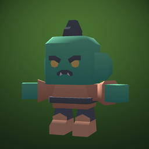
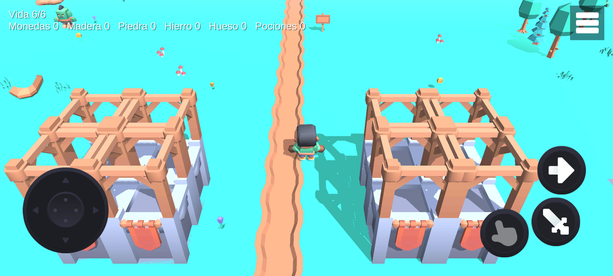
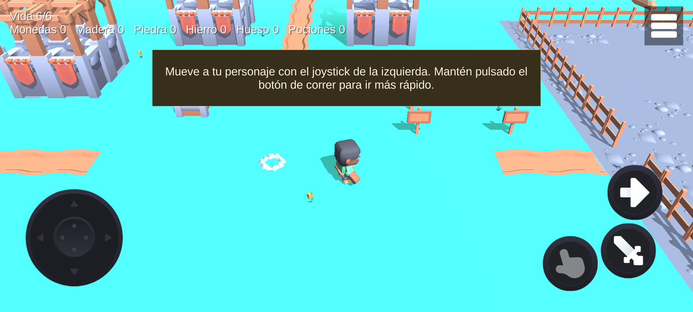
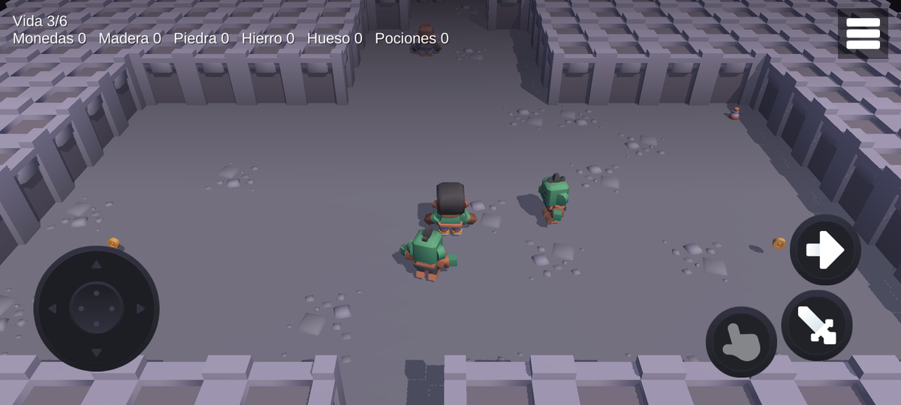
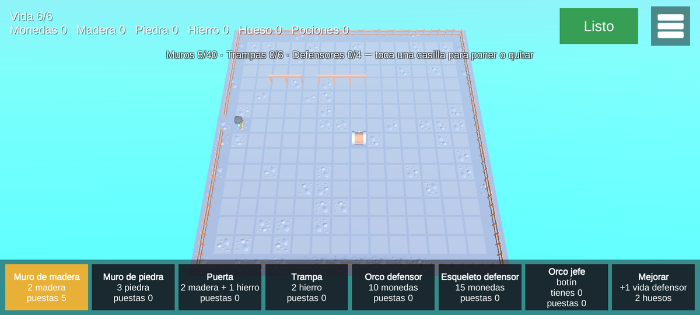
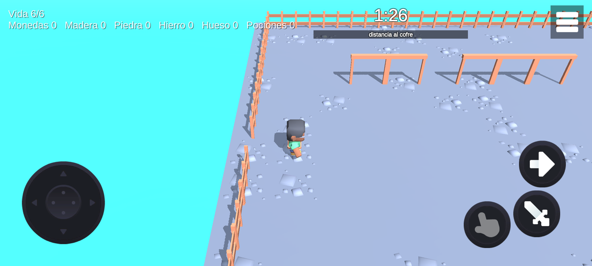
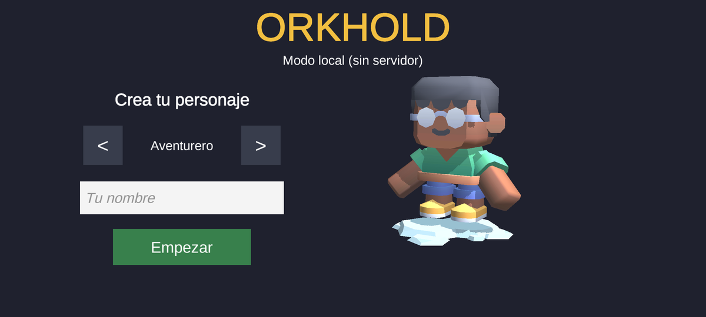
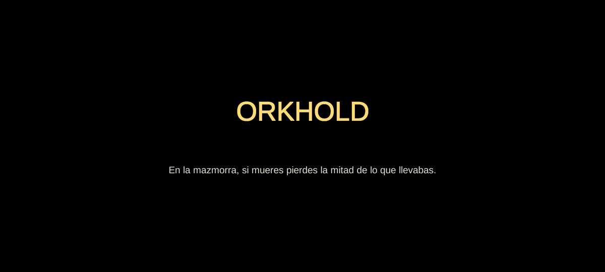

[English](README.md) · **Español**

<div align="center">



# Orkhold

**Juego de móvil online low-poly: explora un pueblo compartido, supera mazmorras, construye tu fuerte y asalta los fuertes de otros jugadores.**




[](#instalación)
[](docs/02-arquitectura.md)
[](docs/01-diseno.md)

</div>

## Para qué sirve

Orkhold es un juego de móvil en 3D visto desde arriba, hecho con Unity 6 y los packs low-poly CC0
de Kenney. Los jugadores comparten un **pueblo** en línea, donde se ven moverse, talan árboles,
pican rocas y pelean con orcos. Desde el pueblo se entra a la **mazmorra**, un mapa aparte con
enemigos, trampas, un jefe y botín. Cada jugador tiene un **fuerte** propio que construye con lo que
recoge: muros, puertas, trampas y defensores. El PvP es **asaltar** el fuerte de otro jugador y
llegar a su cofre antes de 90 segundos.

## Qué hace

| Parte | Qué hay |
|---|---|
| Pueblo online | Varios jugadores en el mismo pueblo con Netcode for GameObjects; el servidor mueve a todos, lleva los orcos y decide el botín |
| Tutorial | Cinco carteles junto a la fogata explican moverse, atacar, recoger, la mazmorra y el fuerte |
| Mazmorra | Catacumbas con orcos, arqueros, esqueletos, trampas y un jefe que da una unidad; si mueres, pierdes la mitad del botín |
| Fuerte | Editor por casillas: 7 piezas con coste, límites y mejoras de defensores |
| Asalto | 90 s para llegar al cofre de un rival; ranking con puntuación tipo Elo e historial |
| Cuentas | API Node 22 + Fastify 5 + PostgreSQL 16: cuenta por dispositivo, inventario, fuertes y asaltos |
| Sin conexión | El pueblo y la mazmorra se juegan en local; el fuerte y el asalto necesitan la API |

<table>
<tr>
<td></td>
<td></td>
</tr>
<tr>
<td></td>
<td></td>
</tr>
<tr>
<td></td>
<td></td>
</tr>
</table>

## Instalación

**Jugar:** compila el APK (ver Uso; no va en git) e instálalo en un Android (ARM64, Android 8 o superior):

```bash
adb install -r Builds/orkhold.apk
```

**Desarrollar:** Unity Hub con **Unity 6000.5.9f1** y el módulo de Android. Para la API, Docker.

```bash
git clone https://github.com/Dasge97/orkhold.git
# Abre la carpeta con Unity Hub. Las escenas se montan solas desde Assets/Mapas/*.txt
# (o menú Prototipo > Montar escenas).
cd orkhold/api && docker compose up -d --build   # API en http://127.0.0.1:3100
```

La API necesita `api/.env` con `POSTGRES_PASSWORD`, `API_SECRETO` y `CLAVE_SERVIDOR`. Ese fichero no
va en git.

## Uso

| Móvil | Teclado (editor) | Acción |
|---|---|---|
| Joystick | WASD / flechas | Moverse |
| Botón espada | Espacio | Atacar: árboles dan madera, rocas piedra, orcos monedas |
| Botón mano | E | Recoger, abrir puertas, usar el tablón o el cofre de asalto |
| Botón flecha (mantenido) | Shift izquierdo | Correr |

Herramientas del editor (menú **Prototipo**) y en línea de órdenes:

| Qué | Cómo |
|---|---|
| Montar escenas | `Prototipo > Montar escenas` |
| Fotos de revisión | `Prototipo > Revisar` (deja fotos en `Revision/`) |
| APK | `Unity -batchmode -buildTarget Android -executeMethod CompilarAndroid.EnBatch -urlApi <url> -mundoApk <host:puerto>` |
| Tests | `Unity -batchmode -runTests -testPlatform PlayMode` (44 tests) y `docker compose run --rm api npm test` (31 tests) |
| Prueba de red | `powershell -File pruebas/red-local.ps1`: un servidor y dos bots que se tienen que ver moverse |

## Configuración

| Dónde | Qué |
|---|---|
| `Assets/Resources/Configuracion.asset` | URL de la API y servidor de mundo. En git van vacíos (modo local); se ponen al compilar el APK |
| Argumentos del ejecutable | `-servidor -puerto 7777` (servidor de mundo), `-mundo host:puerto`, `-api URL`, `-bot` |
| Variables del servidor de mundo | `ORKHOLD_API`, `ORKHOLD_CLAVE_SERVIDOR`, `ORKHOLD_ESTADO` |
| `deployment/` | Compose de producción (PostgreSQL, API, servidor de mundo), Traefik y scripts de codehive |

Los secretos de producción viven en la bóveda Vaultwarden, nunca en el repositorio.

## Cómo funciona

```
Móvil (Unity) ──HTTPS──> API (Fastify) ──> PostgreSQL
     │                        ▲
     └──UDP 7777──> Servidor de mundo (Unity sin ventana) ──clave de servidor──┘
```

- [`docs/01-diseno.md`](docs/01-diseno.md): el juego y sus números.
- [`docs/02-arquitectura.md`](docs/02-arquitectura.md): cliente, red, API, tablas, mapas en texto y despliegue.
- [`docs/03-tareas.md`](docs/03-tareas.md): las nueve fases y su estado.
- [`docs/05-diario.md`](docs/05-diario.md) y [`docs/06-decisiones.md`](docs/06-decisiones.md): diario y decisiones tomadas.

Arte: packs de [Kenney](https://kenney.nl) Mini Dungeon, Mini Characters, Nature Kit y Mobile Controls, todos CC0.

## Licencia

Todos los derechos reservados. Los recursos de Kenney son CC0.
