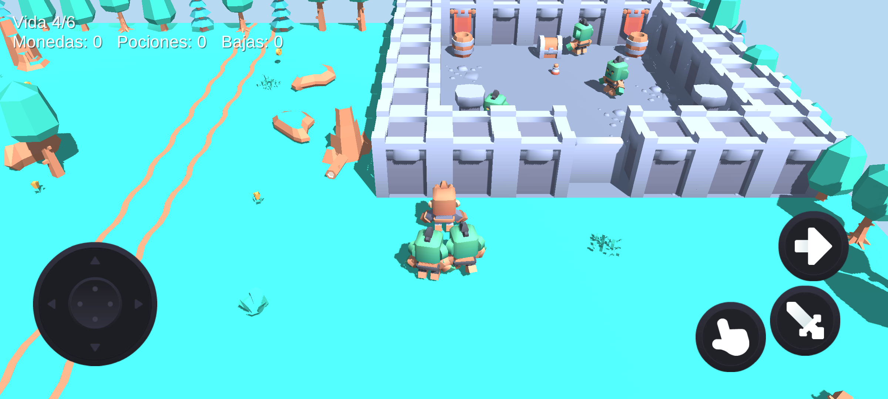

[English](README.md) · **Español**

<div align="center">

# Orkhold

**Juego de móvil online low-poly: explora un pueblo compartido, supera mazmorras, construye tu fuerte y asalta los fuertes de otros jugadores.**


[](docs/02-arquitectura.md)
[](docs/01-diseno.md)
[](docs/03-tareas.md)

</div>

## Para qué sirve

Orkhold es un juego de móvil en 3D visto desde arriba, hecho con Unity 6 y los packs low-poly CC0
de Kenney. Los jugadores comparten un **pueblo** que crece con el tiempo. Desde el pueblo entran a
**mazmorras** (cada una un mapa aparte y un nivel, con su jefe y su botín) y tienen un **fuerte**
propio en un lateral del mapa, construido con los materiales que recolectan. El PvP es **asaltar**
el fuerte de otro jugador: romper muros, esquivar trampas, vencer a los defensores y llegar al
cofre del tesoro a tiempo.

El estado actual es un prototipo PvE jugable: suelo del pueblo, árboles, una sala de mazmorra con
seis orcos, monedas, pociones, controles en pantalla y HUD, funcionando en un emulador de Android.

## Qué hace hoy

| Función | Estado |
|---|---|
| Joystick virtual + 3 botones (atacar, interactuar, correr) | Hecho |
| Héroe con animaciones de andar, correr, atacar, recoger y morir | Hecho |
| Orcos que patrullan, persiguen, pegan y sueltan monedas | Hecho |
| Monedas y pociones, HUD de vida e inventario | Hecho |
| Escena montada automáticamente desde los modelos de Kenney | Hecho |
| Revisión automática (capturas + juego simulado) y compilación del APK | Hecho |
| Mapas en ficheros de texto, mazmorras como escenas aparte | Previsto (fase 1) |
| Construcción del fuerte y asaltos | Previsto (fases 4-5) |
| Cuentas, API, pueblo online | Previsto (fases 6-7) |


## Instalación

Requisitos: Unity Hub con **Unity 6000.5.9f1** y el módulo de Android; para el emulador, Android
Studio con una imagen x86_64 (con traducción de ARM).

```bash
git clone https://github.com/Dasge97/orkhold.git
# Abre la carpeta con Unity Hub. La primera vez, Unity importa los modelos y
# Assets/Editor/MontarEscenaPvE.cs monta Assets/Scenes/PvE.unity solo.
```

## Uso

| Móvil | Teclado (editor) | Acción |
|---|---|---|
| Joystick | WASD / flechas | Moverse |
| Botón espada | Espacio | Atacar (1 de daño; los orcos tienen 3 de vida) |
| Botón mano | E | Recoger lo más cercano, o beber poción si falta vida |
| Botón flecha (mantenido) | Shift izquierdo | Correr |

Menú **Prototipo** del editor:
- **Montar escena PvE** — vuelve a montar la escena desde cero.
- **Revisar (fotos + informe)** — hace capturas, entra en Play, anda y ataca, escribe `Revision/informe.txt`.
- **Compilar APK** — genera `Builds/orkhold.apk` (IL2CPP, ARM64, OpenGL ES 3).

Probar en el emulador:

```bash
emulator -avd Medium_Phone_API_36.0 -gpu host
adb install -r Builds/orkhold.apk
adb shell monkey -p com.orkhold.game 1
```



## Configuración

Todo está en el código y en `docs/`. Todavía no hay fichero de configuración. Servidor, API y
credenciales llegan en las fases 6-8 (ver la lista de tareas); los secretos vivirán en la bóveda
Vaultwarden, nunca en el repositorio.

## Cómo funciona

- `docs/01-diseno.md` — diseño del juego: pueblo, mazmorras, piezas del fuerte, reglas del asalto, pantallas, números.
- `docs/02-arquitectura.md` — cliente, servidor de mundo (Netcode for GameObjects), API (Node + Fastify), PostgreSQL, formato de mapas en texto, rutas y tablas.
- `docs/03-tareas.md` — lista de tareas ordenada, nueve fases, cada una con su comprobación.
- `docs/05-diario.md` — diario de implementación.
- `CLAUDE.md` — reglas de trabajo para el modelo que implementa las tareas.

Arte: packs de [Kenney](https://kenney.nl) Mini Dungeon, Mini Characters, Nature Kit y Mobile Controls, todos CC0.

## Licencia

Proyecto privado. Todos los derechos reservados. Los recursos de Kenney son CC0.
